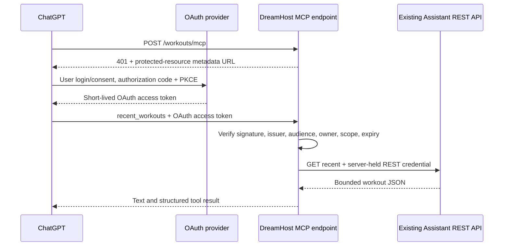

# Read-only Fieldwork MCP connection

This adds an **optional, disabled-by-default** MCP resource server for ChatGPT plugins. It exposes only `recent_workouts`. It cannot append sets, create workouts, edit/delete data, or call the browser sync API. Set logging is a later change after a read-only connection and ChatGPT Live have been verified.

The OAuth authorization server is an established external provider, not a new login/token server implemented in Fieldwork. Auth0 is the documented starting point. No provider account, production connection, plugin installation, deployment, or production-data test is created automatically.

## Architecture and boundaries



OAuth credentials and the existing REST token are separate. ChatGPT never receives the REST token. The adapter reads it from the existing owner-only `~/.fieldwork/assistant-client-token.txt` file, matching the provisioning instructions used for this installation. Rotating that credential requires securely updating this file; the original API still enforces its expiry and revocation. Do not put either access tokens or client secrets into chat, manifests, Git, browser code, or URLs.

The MCP SDK is the official `mcp/sdk` PHP SDK (currently pre-1.0), with its maintained OAuth resource-server validator and `firebase/php-jwt`. Exact dependency versions are locked in `composer.lock`. The adapter delegates login, consent, PKCE, OAuth client registration, refresh and token issuance to the provider. It does **not** expose local `/authorize`, `/token`, or dynamic-client-registration endpoints, and it does not reuse or relax the website's session/CSRF authentication.

Validation requires all of the following on **every** MCP request, including requests using an existing MCP session:

- RS256 signature from the configured issuer's discovered JWKS, with key rotation and bounded public-key caching.
- Exact issuer and audience (`https://borderseng.com/workouts/mcp`). The token must have the RFC 9068 `at+jwt` type; ID tokens and the existing REST bearer token cannot authorize MCP.
- Your exact immutable provider user ID (`sub`), not an email/domain match. Other accounts in the same OAuth tenant remain forbidden even if they have the read scope.
- The exact `workouts:read` scope, integer `iat`/`exp`, and a lifetime of at most one hour. Expiry, future issuance/not-before, and signature checks use the SDK's 15-second clock-skew allowance.

The provider must publish discovery and keys at its configured HTTPS origin. Cross-origin JWKS URLs, redirects and token-supplied key URLs are not followed. Key/REST fetches have connection/read timeouts, a wall-clock read deadline, and a 1 MiB response bound. REST is a fixed GET to the same-origin Assistant endpoint; tool arguments cannot select a URL, action, HTTP method or credential. Unknown response fields and empty object/array types survive the bridge.

## Routes and protocol

- MCP endpoint: `https://borderseng.com/workouts/mcp`
- Metadata: `https://borderseng.com/workouts/.well-known/oauth-protected-resource`
- OAuth scope: `workouts:read`
- Tool: `recent_workouts`, with optional integer `limit` from 1 to 20 (default 5).

The metadata URL is advertised explicitly in the OAuth `WWW-Authenticate` challenge. Clients follow this URL rather than relying on root-level discovery. This keeps the existing website homepage and root `.htaccess` untouched. No files are installed at the domain's root. Verify this challenge-based discovery with the actual ChatGPT connection before enabling production use.

Streamable HTTP POSTs return JSON. The SDK handles both the 2025-11-25 handshake/session protocol and the 2026-07-28 per-request protocol; integration tests exercise both. SSE GETs, DELETE, batching, subscriptions, tasks and other RPC methods are deliberately unavailable on shared hosting. The allowed RPCs are initialize, notifications/initialized, ping, tools/list and tools/call. Only the read tool is registered. Tool annotations mark it read-only and non-destructive; annotations do not replace server authorization.

Host is pinned to the configured resource URL. Requests with Origin must use the same origin or `https://chatgpt.com`; there is no wildcard CORS. Missing Origin does not bypass OAuth. Body and bearer-header sizes are bounded. Admission is limited to 120 requests per minute per fixed hashed-IP slot (256 slots), plus 120 authenticated requests per minute globally. Exhaustion returns 429 with Retry-After. These are fixed windows, not network DDoS protection. Existing REST limits still apply independently.

MCP uses a dedicated 0700 private directory, 0600 session/cache/rate files and a 15-minute SDK session TTL with per-session locking and expiry cleanup on each request. Only the allowed owner can create sessions, and the global budget bounds session creation. Cache/session files never store either raw bearer credential. JWT access-token revocation otherwise follows the provider's short expiry (maximum one hour); setting the local configuration's `enabled` to false disables MCP immediately, even for existing sessions. REST-token revocation also prevents further workout reads. File storage assumes one host with local reliable locking.

No SDK exception messages, headers, tokens, claims or workout bodies are logged by the adapter. The SDK uses its default null logger. Monitor HTTP error counts through hosting metrics without request-body/Authorization logging. Do not supply credentials in URLs, which hosting access logs may retain.

## Provider setup — not yet performed

Since there is no existing provider account, create one before enabling MCP. Auth0's MCP guidance is linked below; another provider is usable only if it meets the same requirements.

1. Create an Auth0 tenant and your own login account. Record your exact issuer URL and immutable user ID from the provider dashboard privately. Disable public signup if it is not needed; the adapter's owner-ID check remains mandatory either way.
2. Register an API whose identifier/audience is exactly `https://borderseng.com/workouts/mcp`. Define the `workouts:read` permission and grant it only as intended. Configure RS256, the RFC 9068 access-token profile (`typ: at+jwt`), and an access-token lifetime of **3600 seconds or less**.
3. Configure the provider's MCP authorization support so ChatGPT's requested `resource` maps to this API audience. Do not assume a provider's generic OAuth defaults perform that mapping. Test that the resulting access token contains the correct audience, subject and scope without posting it in chat or using a public token decoder.
4. Use a provider-supported ChatGPT registration method. Prefer the provider's supported MCP/CIMD integration; otherwise use a pre-registered OAuth application through the plugin connection portal. Use the **actual callback URL shown by that portal**, not an invented callback. Enable authorization-code flow with PKCE S256. If a provided confidential client needs its OAuth client secret, enter that secret only in the portal's dedicated secret field. The Fieldwork REST token is not that client secret.
5. Confirm the issuer publishes discovery metadata, authorization/token endpoints, JWKS, S256 support and the registration method selected. The MCP adapter does not supply missing provider features. Availability and provider pricing/feature gates must be checked in the account you create.

No client ID or secret is committed by this change. The provider configuration and live ChatGPT authorization flow are **not verified** by the local fixture tests.

References verified while preparing this change:

- [OpenAI MCP authentication](https://developers.openai.com/plugins/build/auth)
- [Plugin submission and connection limitations](https://developers.openai.com/plugins/deploy/submission)
- [Auth0 MCP overview](https://auth0.com/ai/docs/mcp/intro/overview)
- [Official PHP MCP SDK](https://github.com/modelcontextprotocol/php-sdk)
- [ChatGPT Voice/Live](https://help.openai.com/en/articles/20001274-chatgpt-voice)

## Build and later operator setup

Do not run this section until the PR has been reviewed and you intend to enable the connection. It creates private configuration and, in the deployment step, changes the hosted release. No workout schema migration is needed beyond the Assistant schema already installed.

The optional MCP dependencies need Composer 2 and PHP 8.1+ with OpenSSL and fileinfo on the build machine and host. From the updated **local** checkout:

```sh
npm run setup:mcp
npm run build:hosted
```

`npm run build:hosted` includes installed vendor dependencies in the release. If Composer dependencies have not been installed, it still builds the ordinary website/REST app and warns that MCP is unavailable. The deployer's MCP preflight refuses to activate an enabled MCP configuration with missing dependencies/extensions or an unsafe/missing local REST-token file. Thus an existing website-only build remains usable, while an enabled MCP deployment cannot silently omit its dependencies.

Copy only the setup tool and its configuration helper to the server's private tools directory, from your local checkout:

```sh
tar -cf - scripts/mcp/setup.php server/mcp/config.php |
ssh jborders@borderseng.com \
  'umask 077; mkdir -p "$HOME/.fieldwork/tools"; tar -xf - -C "$HOME/.fieldwork/tools"'
```

In your SSH session, run the interactive setup. It asks for the exact issuer and user ID; it does **not** ask you to paste a secret. It refuses to overwrite an existing configuration.

```sh
export FIELDWORK_PRIVATE_DIR="$HOME/.fieldwork"
php "$HOME/.fieldwork/tools/scripts/mcp/setup.php"
```

This writes owner-only `~/.fieldwork/mcp-config.json` with the enabled flag, canonical resource URL, issuer and owner subject. Keep the existing shared `.fieldwork` root's traversal permissions; do not change that root to 0700. MCP creates its own private subdirectory.

Then deploy from the local checkout using the existing `npm run deploy:dreamhost` workflow. This step is **not** performed by development/testing. Preflight verifies local configuration/dependencies/token-file shape; it makes no OAuth-provider or database request and does not prove the connection is live. The Assistant REST credential's hash/expiry is still checked by the original API when a read is attempted.

## Plugin Creator handoff / live verification

After a later deployment, give Plugin Creator the MCP endpoint, metadata URL, scope and OAuth provider/registration details above. It can assemble the plugin connection/package through its supported UI. Do not create an API-key-auth manifest or paste the REST secret into the plugin; this adapter requires OAuth. No final plugin manifest with an unknown client registration is generated by this PR.

First connect through the provider's real login/consent screen. Confirm that only `recent_workouts` is available, then explicitly request a recent-workout read. A generic tool failure can mean the server-side REST credential expired or needs updating; do not rotate/re-authorize OAuth automatically in response to that separate failure. Do not create test sets in production.

Test the installed plugin during an actual ChatGPT **Live** conversation. Current documentation supports available plugins/apps in Live, subject to account/workspace restrictions. On-screen approval is required when an action needs approval; spoken approval is not supported. Live connection and physical-iPhone behavior remain unverified until the user performs these checks. This read-only PR deliberately cannot log sets.

## Reproducible development tests

```sh
npm run setup:mcp
npm test
npm run build:hosted
PHP_BINARY=php python scripts/mcp/test-setup.py
PHP_BINARY=php FIELDWORK_ASSISTANT_TEST_CONFIG=/absolute/path/to/local-admin-config.json python scripts/run-assistant-tests.py
```

The existing runner creates/drops a uniquely named local MariaDB database, configures synthetic credentials, and starts disposable loopback servers. The MCP test adds an ephemeral issuer with local RSA signing keys, discovery, a synthetic authorization-code/PKCE exchange, and a separate MCP PHP listener. It compares every workout/revision/audit receipt before and after MCP calls. It never accepts a production target.

Coverage includes disabled/default behavior; metadata and challenges; handshake and per-request protocols; owner/issuer/audience/signature/algorithm/type/expiry/scope rejection; wrong/single-use PKCE codes in the fixture; JWKS rotation; request limits/rates; blocked write tools/subscriptions; HTTP redirects/size/deadline handling; issuer-origin pinning; the actual Assistant REST read bridge with JSON type/unknown-field preservation; credential failures; private cache/session modes and absence of stored tokens; disablement for existing sessions; and safe logs. The same run also executes the ordinary Assistant/sync API and browser login/CSRF/offline regressions.

The synthetic issuer is test machinery, not an OAuth server to deploy. The PHP SDK's pre-1.0 status, Composer dependency footprint, real provider configuration and ChatGPT connection deserve review before production rollout.
